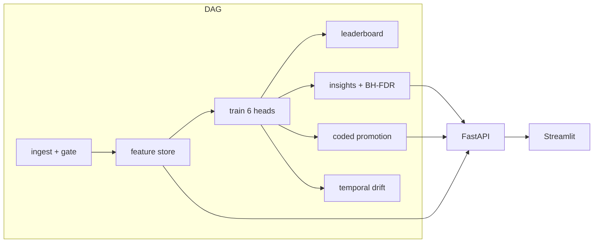

# Netflix Content Analytics Engine

This platform analyses **catalogue composition and platform acquisition behaviour**, not audience success. The shipped listing (`data/raw/netflix_titles.csv`) has `show_id`, `type`, `title`, `director`, `country`, `date_added`, `release_year`, `rating`, `duration`, `listed_in` — and **no** view count, watch time, completion rate, revenue, subscriber impact, IMDb / Rotten Tomatoes score, awards, budget, or renewal status. Those fields would be required to measure content success; they are not here, so every target in this repository is an explicitly labelled **proxy**. See [`reports/target_definitions.md`](reports/target_definitions.md) and [`docs/DATA_ROADMAP.md`](docs/DATA_ROADMAP.md).

**Live URLs** (fill after deploy): API `TBD` · Dashboard `TBD`

  

The insight engine applies Benjamini–Hochberg FDR and an effect-size floor. The latest pipeline run tested **86 candidate findings; 27 survived BH-FDR at q = 0.05 with the configured effect-size floor.** That sentence is regenerated in `reports/insights.md` by the insights stage. Comparisons that are true by definition (type vs `is_movie`, acquisition bucket vs `years_to_platform` / `is_likely_original`) are not candidates.

---

## Quickstart

```bash
python -m venv .venv
# Windows: .venv\Scripts\activate
# Unix:    source .venv/bin/activate
pip install -r requirements-dev.txt
# CSV is already at data/raw/netflix_titles.csv
make pipeline          # or: python scripts/run_pipeline.py
make test
make api               # http://127.0.0.1:8000/docs
make dashboard         # http://127.0.0.1:8501
```

Docker (API :8000, dashboard :8501):

```bash
docker compose up --build
```

A second `make pipeline` on an unchanged tree skips every stage from cache in seconds. `--from-stage features` reruns that stage and everything after.

Search spaces are sized so a laptop CPU run stays near the 15-minute budget. `NETFLIX_FAST=1` shrinks `n_iter` further for tests. The shipped search uses `n_iter: 8` (not 30): a 30-draw search of the tree ensembles on this catalogue does not finish in 15 minutes. The spaces themselves are unchanged.

## Architecture



Orchestration is a hand-rolled local DAG (not Airflow). MLflow is a local file store. The feature store is one parquet plus a per-task allow-list. Details: [`docs/ARCHITECTURE.md`](docs/ARCHITECTURE.md).

## Model suite

| head | task | primary metric | baseline |
|---|---|---|---|
| A type | binary | ROC-AUC | Dummy most-frequent |
| B rating | ordinal 4-level | QWK | Dummy most-frequent |
| C acquisition lag | regression on `log1p` | MAE (original scale) | Dummy median |
| D acquisition bucket | ordinal 4-level | QWK | Dummy most-frequent |
| E segments | spherical k-means | silhouette + bootstrap ARI | — |
| F monthly volume | forecast | MAE | **seasonal-naive** (must be reported even if it wins) |

Heads C/D are **acquisition priority**, never success. Duration and TV-prefixed genres are banned from Head A. Every `date_added`-derived column is banned from Heads C/D. Leakage tests live in `tests/unit/test_leakage.py`.

The leaderboard at `reports/model_leaderboard.md` is generated by a script, not hand-written.

## Insight engine

Right test per comparison (Mann-Whitney default — catalogue metrics are skewed), effect-size floor, BH-FDR across the whole candidate set, minimum support, nested dedup, importance ranking. Templated English only; causal verbs fail CI. Methodology and the candidate/survivor counts are in `reports/insights.md`.

## MLOps

- Pandera + custom **validation gate** that fails the pipeline on bad data (`reports/validation_report.html`).
- MLflow local tracking + JSON sidecars.
- Coded promotion with named gates (`make promote` is refusable).
- Temporal drift on the real `date_added` split (`reports/drift_report.html`).
- Runbook: [`docs/RUNBOOK.md`](docs/RUNBOOK.md). Model card: [`docs/MODEL_CARD.md`](docs/MODEL_CARD.md).

## API

See [`docs/API.md`](docs/API.md). `/analyze` labels proxy targets as proxies **in the response body**. `/predict/type` rejects `duration` (422). `/predict/acquisition` rejects `date_added` / `year_added` (422).

## Honest limitations

1. There is no success signal. Proxies measure platform intent and metadata richness.
2. `cast` and `description` are absent from the shipped file, so `catalogue_prominence` is weaker than the five-term spec.
3. Monthly add-volume has ~100 points and a 2020 structural break; forecasts beyond a few months are weakly supported.

Next step: an optional TMDB/OMDb join behind `ENRICHMENT_ENABLED` (off in CI). See [`docs/DATA_ROADMAP.md`](docs/DATA_ROADMAP.md).

## Makefile

`setup` `ingest` `features` `train` `evaluate` `insights` `promote` `drift` `pipeline` `test` `lint` `format` `api` `dashboard` `run` `mlflow-ui` `docker-build` `docker-up` `clean`
