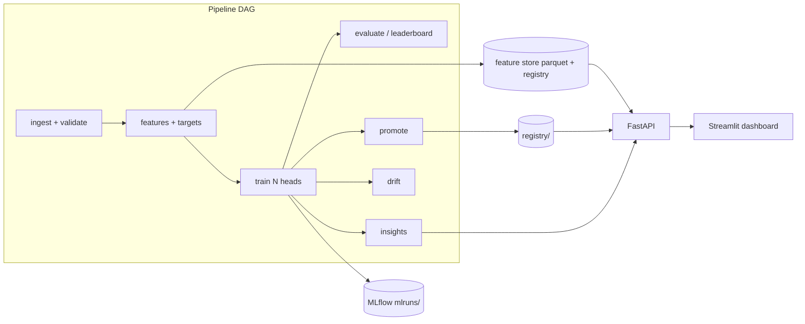

# Architecture

The platform is a **plain-Python DAG**, not an Airflow deployment. A single
container does not justify a scheduler server. Prefect was considered and
rejected for the same reason: the default path must not require a server.

## Orchestrator

`src/pipeline/orchestrator.py` walks `STAGE_ORDER`. Each stage:

- hashes its inputs, the four YAML configs, and `src/**/*.py`
- skips with a log line when the `_SUCCESS` manifest still matches
- is independently runnable as `scripts/0N_*.py`
- records git SHA, duration, and row counts

`--from-stage features` forces that stage and everything after.

## Feature store

One parquet, one `feature_registry.json`. Learned transforms (TF-IDF,
scalers) stay **inside** each sklearn pipeline and are fitted per fold.
The registry carries a per-task allow-list; a test fails if a banned
feature reaches a head. A schema hash is stored so a model trained on an
older feature set is refused at load time.

## Tracking and promotion

MLflow uses a local file backend (`mlruns/`). Every run is also written
as JSON under `artifacts/runs/` so the leaderboard does not depend on a
tracking server. Promotion (`src/tracking/promote.py`) is a coded rule:
beat the dummy baseline by a configured margin, beat the incumbent, no
banned features, calibration and latency gates. A refusal prints the
failing gate name.

## Serving

FastAPI loads artifacts once in a lifespan handler. Streamlit talks HTTP
only (`API_BASE_URL`) and never imports a model. Models are baked into
the image; free-tier containers must not train at startup.

## Deliberate trade-offs

| choice | not chosen | why |
|---|---|---|
| Hand-rolled DAG | Airflow, Prefect server | infra time would replace product time |
| Local MLflow files | hosted tracking | no server to operate; still queryable |
| Parquet feature store | Feast | one dataset, one machine |
| Residual-quantile intervals | conformal / Bayesian | honest, cheap, and sufficient given MAE of years |
| Hand-rolled drift HTML | Evidently in the runtime | dependency weight and arm64 risk |
